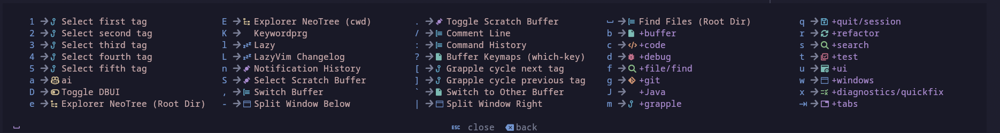
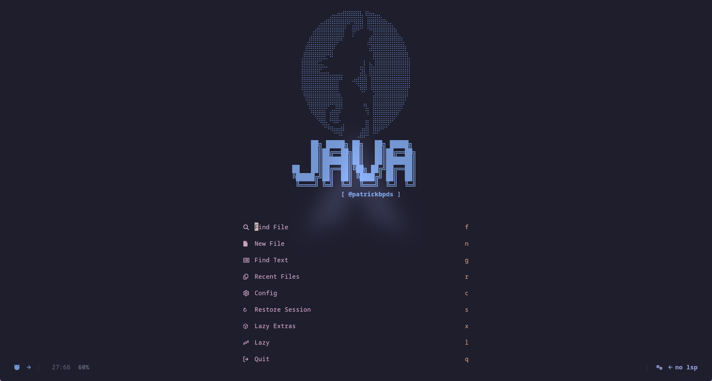

# Engineering Workstation Dotfiles

Versioned Neovim and OpenCode configuration for Java/Spring Boot backend work.
The desktop stack (Arch Linux, Hyprland, Zsh, Alacritty, Zen Browser, and the
current theme) is intentionally left untouched; this repository covers the
editor and AI-agent layers.

The setup is built on [LazyVim](https://github.com/LazyVim/LazyVim), with JDTLS
for Java, `nvim-dap` for debugging, `rest.nvim` for HTTP/GraphQL requests, and
OpenCode as the primary coding agent.

## Preview






## What is included

- **Java/Spring Boot:** JDTLS, Lombok, Google Java Style, Maven/Gradle
  wrapper-aware builds, JUnit through the JDTLS test runner, DAP debugging,
  profiles, Flyway migrations, dependency management, and generators.
- **AI workflow:** `opencode.nvim` for in-editor prompts, diffs, sessions, and
  visual selections; Context7 as the only default MCP.
- **HTTP/GraphQL:** `.http` files with request replay, environments, cookies,
  and a rendered response pane.
- **SQL:** Dadbod UI, SQL completion, and sqlfluff.
- **Git:** Snacks Lazygit, gitsigns, Fugitive for `:Git`, and Octo for GitHub.
- **Editor UX:** fzf-lua, Neo-tree, Blink, Supermaven, which-key, sessions, and
  the existing Catppuccin/Heimdall theme.
- **Deterministic maintenance:** pinned plugins, no automatic update checker,
  lazy-loaded network-bound tools, and headless tests for the Java toolbox.

## Architecture

```text
┌──────────────────────────────────────────────────────────────┐
│ Neovim 0.12 + LazyVim                                        │
│  editor · pickers · Git · sessions · UI                      │
├──────────────────┬──────────────────┬────────────────────────┤
│ Java             │ AI               │ HTTP / API             │
│ jdtls            │ OpenCode         │ rest.nvim              │
│ nvim-dap         │ Context7 MCP     │ .http / GraphQL        │
│ Maven / Gradle   │ java-backend     │ environments           │
└──────────────────┴──────────────────┴────────────────────────┘
```

### One primary tool per responsibility

| Responsibility | Choice | Why |
| --- | --- | --- |
| Completion | Blink + Supermaven | Blink handles LSP/completion; Supermaven stays inline-only |
| Java LSP | JDTLS | Native Java tooling, Lombok, DAP, and test support |
| Java tests | JDTLS test runner | Avoids a duplicate `neotest-java` adapter |
| XML/POM | LemMinX | Maven/Spring XML with explicit project-root markers |
| Agent | OpenCode | Primary coding agent; completion remains separate |
| Docs MCP | Context7 | Read-only, remote, no OAuth, no stored key |
| REST | `rest.nvim` | Open source; Kulala now requires a commercial license token |
| Git UI | Snacks Lazygit | One primary UI; gitsigns/Fugitive/Octo cover narrow cases |
| SQL | Dadbod UI | Editor-native queries without a database MCP |

### Deliberate exclusions

- No `spring-boot.nvim`: the custom `lua/java/` toolbox owns Spring run,
  profiles, generators, and migrations.
- No `neotest-java`: the JDTLS test runner is the single Java test path.
- No Kulala: its core binary requires a license token.
- No additional completion provider or second AI agent.
- No PostgreSQL, GitHub, Playwright, Sentry, or filesystem MCP by default.
  Add one only when a workload needs it, with minimal permissions.

## Validated baseline

Validated on Arch Linux on **2026-11-23**:

| Component | Version / commit |
| --- | --- |
| Neovim | 0.12.6 |
| LazyVim | `99970099` |
| lazy.nvim | `85c7ff37` |
| JDTLS | 1.60.0 |
| java-debug-adapter | 0.59.0 |
| java-test | 0.47.0 |
| LemMinX | 0.29.3 |
| OpenCode CLI | 2.4.1 |
| opencode.nvim | `3cab89df` |
| rest.nvim | `714d5512` |
| Java | Temurin 21.0.12.1 LTS |

## Requirements

- Neovim **0.11.2+** with LuaJIT (validated on 0.12.6).
- JDK **21+** for JDTLS; project JDKs 17/21 are auto-detected.
- Git, `ripgrep`, `fd`, `curl`, and `luarocks`.
- OpenCode CLI with a connected provider.
- Maven or Gradle, preferably via `./mvnw` / `./gradlew`.

## Install

Back up existing configuration before linking anything.

### Link Neovim

For a fresh machine, link the whole directory:

```bash
mkdir -p ~/.config
ln -s ~/.dotfiles/nvim ~/.config/nvim
```

The current machine uses per-file links instead; both layouts are valid. Do not
copy generated files over the repository.

Start Neovim once:

```bash
nvim
```

lazy.nvim installs pinned plugins, and Mason installs the servers declared in
`nvim/lua/plugins/lsp.lua`. If needed:

```vim
:MasonInstall jdtls java-debug-adapter java-test lemminx
```

### Link OpenCode

OpenCode’s config directory also contains local TUI/plugin state, so link only
the repository-owned files:

```bash
mkdir -p ~/.config/opencode
ln -sfn ~/.dotfiles/opencode/opencode.json ~/.config/opencode/opencode.json
ln -sfn ~/.dotfiles/opencode/AGENTS.md ~/.config/opencode/AGENTS.md
ln -sfn ~/.dotfiles/opencode/skills ~/.config/opencode/skills
```

Do not symlink the whole `~/.config/opencode` directory; it would hide the
existing local plugins and TUI configuration.

Verify:

```bash
opencode debug config
opencode mcp list
```

Inside Neovim:

```vim
:Lazy load opencode.nvim
:checkhealth opencode
```

## Repository layout

```text
.
├── nvim/
│   ├── init.lua
│   ├── lazyvim.json
│   ├── lazy-lock.json
│   ├── lua/config/              # core options, keymaps, autocmds, lazy.nvim
│   ├── lua/java/                # Java/Spring toolbox and generators
│   ├── lua/lang_servers/        # Google Java Style profile
│   ├── lua/plugins/             # plugin specs (LSP, REST, OpenCode, Git, UI)
│   ├── lua/user/heimdall.lua    # generated theme palette
│   └── tests/                   # headless specs for the Java toolbox
├── opencode/
│   ├── opencode.json            # global permissions, MCP, watcher ignores
│   ├── AGENTS.md                # global working agreement
│   ├── skills/java-backend/     # repository-owned Java/Spring skill
│   └── README.md                # OpenCode architecture and security notes
├── KEYMAPS_LEARNING.md          # keymap tutorial
└── assets/                      # screenshots
```

Detailed documentation:

- [`nvim/README.md`](nvim/README.md) — editor, Java, AI, REST, SQL, validation.
- [`opencode/README.md`](opencode/README.md) — agent policy, MCP, skills.
- [`KEYMAPS_LEARNING.md`](KEYMAPS_LEARNING.md) — progressive keymap guide.

## Common commands

### Neovim

```vim
:Lazy check                 " review plugin updates
:Lazy update                " apply updates
:Lazy profile               " startup profile
:Mason                      " installed/available servers
:checkhealth                " full health report
:JavaCommands               " list every Java command
```

### OpenCode

```bash
opencode                       # start the TUI
opencode mcp list              # MCP connection status
opencode debug config          # resolved config documents
opencode reload                # reload config in the running service
```

### Validation

Run the same checks locally from the repository root:

```bash
cd nvim
stylua --check lua init.lua tests
luacheck lua init.lua tests
./tests/run.sh
cd ..
markdownlint-cli2 README.md KEYMAPS_LEARNING.md nvim/README.md \
  opencode/AGENTS.md opencode/README.md opencode/skills/java-backend/SKILL.md
```

The CI workflow under `.github/workflows/nvim.yml` runs all of these checks. It
uses pinned action commits and these tool versions: StyLua 2.5.2, Luacheck
1.2.0, Neovim v0.12.6 for the headless Java specs, and markdownlint-cli2
0.23.2. Install them locally with `cargo install stylua --version 2.5.2`,
`luarocks install luacheck 1.2.0`, a Neovim v0.12.6 release, and
`npm install --global markdownlint-cli2@0.23.2`.

CI has `contents: read` only. To reproduce a failure, run the commands above
with those versions; do not weaken a check to force a green result.

## Verified behavior

The following checks were executed locally and passed:

- StyLua 2.5.2 and Luacheck 1.2.0: 0 warnings, 0 errors across 34 files;
  Markdown lint: 0 issues in 6 documents.
- `./tests/run.sh`: all Java toolbox specs passed.
- Warm startup: 28–36 ms in quiet runs; cold first run: 129 ms.
- JDTLS attach, `:JdtCompile`, `:JavaCommands`, LemMinX on `pom.xml`, and
  2-space Google-style formatting.
- `<leader>tt` executed two JUnit tests successfully through the JDTLS DAP
  runner.
- Full DAP session in a disposable Java 21 project: breakpoint hit at line 8,
  Step Over advanced to line 9, Continue terminated the session, and Locals
  were readable (`a=40`, `b=2`, `sum=42`).
- Maven 4.0.0-rc-6: `mvn test` and `mvn package` passed on Java 21 (2 JUnit
  tests, jar built). A disposable Gradle 8.14.3 wrapper project passed
  `./gradlew test` and `./gradlew build`; Gradle was not installed system-wide.
- `rest.nvim` completed a real local HTTP request and rendered status, headers,
  body, timing, and size.
- `:checkhealth opencode` passed with OpenCode 2.4.1. `:checkhealth rest-nvim`
  passed after opening an `.http` buffer (the plugin is filetype-lazy).
- Context7 connected with two tools; live MCP calls retrieved official Spring
  Boot 3.5 and Java SE 21 documentation. `opencode debug config` shows the
  expected `mcp.servers.context7` entry.

Not verified: a real Spring Boot application launch, Kafka/Redis/PostgreSQL
integration tests, Kubernetes/AWS operations, and model-driven skill invocation.
The last was blocked by the configured provider's insufficient-credit response
(HTTP 402), not by a configuration failure.

## Security model

- No tokens, API keys, credentials, or local database URLs are versioned.
- OpenCode shell commands ask by default. Read-only Git and `rg`/`fd` are
  allowlisted; `git commit`, `git push`, `git reset --hard`, and `rm -rf` ask.
- Reads of `.env` files ask; private keys/certificates, SSH material, AWS
  credentials, gcloud config, kubeconfig, `.git-credentials`, `.npmrc`,
  `.pypirc`, Docker auth, and GitHub CLI hosts are denied.
- Edits to `.env*`, `.git`, `target`, `build`, `node_modules`, and the credential
  paths above are denied (`.env.example` is allowed).
- Context7 is the only default MCP and is limited to its two documentation
  tools.
- Permissions are defense in depth, not a sandbox.

## Performance notes

- The LazyVim update checker is disabled; updates are explicit.
- WakaTime is lazy-loaded because its CLI setup is network-bound (previously
  ~88 ms).
- Fugitive, `better-ts-errors`, `rest.nvim`, and `opencode.nvim` are loaded only
  when needed.
- One picker (fzf-lua), one Git UI (Lazygit), one REST client, and one Java test
  runner avoid duplicate work.
- The OpenCode background service is native to OpenCode; Neovim does not start
  permanent background processes of its own.

## Known warnings and next improvements

- The current full `:checkhealth` report includes optional-tool warnings
  (LaTeX/Mermaid/image preview, missing `wget`, pip, Go, PHP, Julia). These do
  not affect Java or the editor workflow.
- Snacks health reports disabled modules because fzf-lua and Neo-tree are the
  chosen UI; this is intentional.
- The Go LazyVim extra is enabled but the Go toolchain is not installed. Remove
  the extra or install Go if that language is used.
- CI runs StyLua, Luacheck, headless Java specs, and Markdown lint; a live DAP
  smoke test remains a manual check.
- GraphQL requests are supported through `.http`; there is no dedicated gRPC
  client or Kubernetes plugin. Those workflows use Java tooling and the
  `java-backend` skill.
- Consider adding a project-scoped `opencode.json` only when a repository needs
  extra MCPs or stricter permissions.

## License

This configuration is provided as-is for development use.
